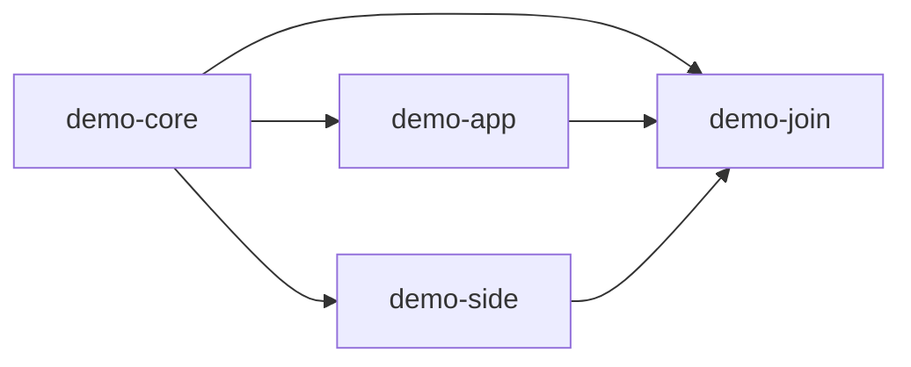

# VOC-Experiments sandbox

[Deployment guide](../../docs/deployment/README.md) · [Architecture](../../docs/architecture/README.md)

This is the configured example deployment. Names, IDs, targets and URLs here are sandbox
settings; they are not controller policy or authorization for production SNodeC resources.

## Services and repositories

| Role | Current setting |
| --- | --- |
| Controller checkout | `/home/voc/projects/snodec/core-ci`, branch `main` |
| Local administration UI | `http://127.0.0.1:8080/` |
| Public signed webhook | `https://gw-home.vchrist.at:8443/github/webhook` |
| Controller LAN endpoint | `192.168.1.239:8443`, router TCP forwarding |
| Database | Private managed MariaDB, application schema `core_ci` |
| Controller App / installation | `5467318` / `175134675` |
| Trusted worker | `VOC-Experiments/ci-coordinator` |
| Source repositories | `demo-core`, `demo-app`, `demo-side`, `demo-join` under `VOC-Experiments` |
| Feed | `VOC-Experiments/packages`, branch `main`, numeric ID `1429576922` |
| Package HTTPS root | <https://voc-experiments.github.io/packages/> |
| Feed-writer App / installation | `5424800` / `174142534` |
| Signing environment | Worker `package-publication`, restricted to `main` |

The controller runs a development build under `/tmp/codex/build/core-ci/public-status-projection`; it is
not installed as a system service. Runtime command/PID and local acceptance artifacts are
under `/tmp/codex/build/core-ci/live-sandbox` and
`/tmp/codex/build/core-ci/public-status-projection/live`. No extra source checkout
is required. GitHub jobs perform all package compilation, signing and publication.

The UI stays on loopback. Public TLS serves the webhook and read-only `/public/status` facts,
with SSL verification enabled in GitHub and raw-body HMAC validation in core-ci. Subscribed App events are Push, Workflow
job and Workflow run. Port 443 remains untouched. The configured TLS files are
`/home/voc/ci-test/core-ci-tls/fullchain.pem` and `private-key.pem`; the HMAC file is
`/home/voc/ci-test/core-ci-webhook.secret`. These paths contain private material and are not
files to commit or include in screenshots.

## Trusted deployment pins

| Identity | Current value |
| --- | --- |
| Worker tooling commit | `96f34e0079d2adbd93a266ddfdeddc9064db37b1` |
| Thin source workflow Git blob | `498dafaf2509aad33832e11bd86c539b4b9ea199` |
| Publication workflow Git blob | `c7aeed28b4388ef33563b6ab5e4b815b1698ad00` |
| Public status workflow Git blob | `1e15779200a5ed7462c19ad167b320b7c98d0def` |
| Source workflow main commits | core `23bd1950102db031cfd476940a32cd64faf2bb54`; app `8795f8c0036126358a9d55e2f4faa3b49f037540`; side `40a8a36657f2c91e9379072160268cfaa427295d`; join `16d354cefe0021dc27107ba31ce217b81b389baf` |

New GitHub run/job names and core-ci labels show repository, source tag, distribution/suite,
architecture, package format and rebuild revision. Full cryptographic evidence remains in
assignments, metadata and UI technical details. Previously selected inputs are immutable.

## Example graph and project files

The additional direct core-to-join edge represents join's direct use of core's header.
Join waits for every declared prerequisite for its target. Core and side export their own
headers/static libraries; app and join do not export other projects' files. Runtime package
ranges remain compatible ranges while build consumption uses exact selected receipts.

[definitions/](definitions) contains explicit source-owned JSON examples.
[ci/](ci) contains the corresponding example build hooks and recipe logic. The worker consumes
these from each selected source commit, not from this checkout during a GitHub build.

| Target | Runner | Format |
| --- | --- | --- |
| Debian trixie amd64 | `ubuntu-24.04` | DEB |
| Debian trixie arm64 | `ubuntu-24.04-arm` | DEB |
| Fedora 43 x86_64 | `ubuntu-24.04` | RPM |
| OpenWrt 24.10 x86_64, target `x86/64` | `ubuntu-24.04` | IPK |
| OpenWrt 25.12 x86_64, target `x86/64` | `ubuntu-24.04` | APK v3 |

OpenWrt roots select the latest stable official SDK in their configured series. Dependents
reuse prerequisite SDK/toolchain identity. The controller contains no SDK/runner catalogue.

## Live verification

The current metadata acceptance source is `demo-join v2.1.4` at
`96db7574f3289f44e2e575bbf9e36f84922566d2`. Build and publication evidence is linked below.
All five builds and publications succeeded, and the controller verified all five targets as
`published`. The feed retains 48 receipt rows. The controller verifies receipts and HTTPS bytes
before marking any target published.

| Target | Build | Publication |
| --- | --- | --- |
| DEB amd64 | [40348588415](https://github.com/VOC-Experiments/demo-join/actions/runs/40348588415) | [40349210169](https://github.com/VOC-Experiments/ci-coordinator/actions/runs/40349210169) |
| DEB arm64 | [40348594466](https://github.com/VOC-Experiments/demo-join/actions/runs/40348594466) | [40349542804](https://github.com/VOC-Experiments/ci-coordinator/actions/runs/40349542804) |
| RPM x86_64 | [40348611580](https://github.com/VOC-Experiments/demo-join/actions/runs/40348611580) | [40354841667](https://github.com/VOC-Experiments/ci-coordinator/actions/runs/40354841667) |
| IPK x86_64 | [40348605399](https://github.com/VOC-Experiments/demo-join/actions/runs/40348605399) | [40351024825](https://github.com/VOC-Experiments/ci-coordinator/actions/runs/40351024825) |
| APK x86_64 | [40348599807](https://github.com/VOC-Experiments/demo-join/actions/runs/40348599807) | [40350191729](https://github.com/VOC-Experiments/ci-coordinator/actions/runs/40350191729) |

Actual apt/dnf/opkg/apk installation and runtime checks cover the five-target example diamond.
[ARM64 APT client](https://github.com/VOC-Experiments/ci-coordinator/actions/runs/40350212237)
and [APK client](https://github.com/VOC-Experiments/ci-coordinator/actions/runs/40351045715)
are representative client evidence. Wrong-key rejection is verified. These client scripts
assert the top-level requested version; compatible runtime dependency resolution is distinct
from exact graph-selected build inputs and static-export runtime output.

Signed ping/redelivery, unsigned-request rejection, real tag selection, duplicate reports and
restart during assigned work are verified at the public endpoint. The five-target webhook
path progresses without an operator calling the reconciliation REST endpoint. Explicit report
redelivery remains available when investigating a particular delivery.

Local graph/pipeline/worker suites use real isolated MariaDB and synthetic service fixtures;
they are not counted as live GitHub jobs. No `--allow-untrusted` installation is used to claim
package-client trust acceptance.

## Public status deployment

The [project status page](https://voc-experiments.github.io/packages/status/demo-join.html)
and its [Markdown version](https://github.com/VOC-Experiments/packages/blob/main/status/demo-join.md)
are generated by the trusted deployment-owned Jinja templates. They show the highest selected
source version, target coordinates, its available packages, first verified publication time,
current work, prerequisite links and verified build logs. In build is a dash when no work is
active. The controller currently retains 60 executions at generation 297.

[Status run 40368835408](https://github.com/VOC-Experiments/ci-coordinator/actions/runs/40368835408)
published the projection, and [Pages deployment 40368892486](https://github.com/VOC-Experiments/packages/actions/runs/40368892486)
made it public. All 13 changed display files were checked byte-for-byte over HTTPS against
feed commit `4af1d4e7d0c2eee5631d716a7c35b4270a2d64c5`. All 265 retained package files,
five trusted key files, signed indexes, receipts and exports stayed unchanged.
[Identical refresh 40369085122](https://github.com/VOC-Experiments/ci-coordinator/actions/runs/40369085122)
also succeeded and left that feed commit unchanged, with no additional signatures.

The status workflow uses `CORE_CI_STATUS_URL=https://gw-home.vchrist.at:8443/public/status`,
the reviewed tooling SHA above and the existing feed-writer App. It receives no signing keys.
Runtime command-line pins are recorded with the running controller command; they override
older values in its protected configuration file. No system-service installation is claimed.

## Current operational limits

- Intermittent GitHub HTTP 403 responses occurred with the feed-writer App despite a valid
  Contents-write installation token. A fresh original status run succeeded without changing
  credentials or permissions. The cause is unresolved; no automatic retry was added.
- Automatic transfer of renewed router certificates and controller restart is not configured.
- Observer-token credential type/minimum scope still needs owner confirmation.
- Feed main has no configured ruleset/branch protection; restrict writers before production use.
- Full live modified-index/package rejection coverage across every format is incomplete.
- Acknowledged tag notifications not yet persisted require explicit rescan/redelivery after a
  crash. This accepted boundary has no durable inbox.
- A deleted/expired original environment artifact can prevent explicit retry from preserving
  its selected image/SDK. core-ci refuses to substitute a newly resolved environment.
- Self-hosted runners require deployment-owned isolation/provenance guarantees; a runner label
  alone does not make their host state trustworthy.

Production activation is a separate deployment decision with its own repositories, hosting,
credentials, key identities and access protection. No production SNodeC workflow/feed/tag is
part of the sandbox setup.
