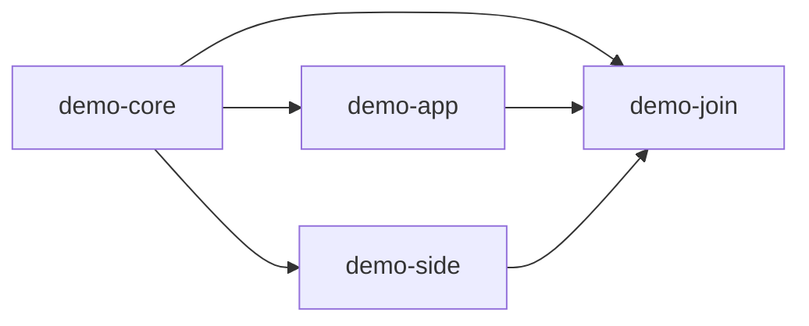

# VOC-Experiments sandbox

[Deployment guide](../../docs/deployment/README.md) · [Architecture](../../docs/architecture/README.md)

This is the configured example deployment. Names, IDs, targets and URLs here are sandbox
settings; they are not controller policy or authorization for production SNodeC resources.

## Services and repositories

| Role | Current setting |
| --- | --- |
| Controller checkout | `/home/voc/projects/snodec/core-ci`, branch `feat/persistent-package-graph` |
| Local administration UI | `http://127.0.0.1:8080/` |
| Public signed webhook | `https://gw-home.vchrist.at:8443/github/webhook` |
| Controller LAN endpoint | `192.168.1.239:8443`, router TCP forwarding |
| Database | Private managed MariaDB, application schema `core_ci` |
| Controller App / installation | `5467318` / `175134675` |
| Trusted worker | `VOC-Experiments/ci-coordinator` |
| Source repositories | `demo-core`, `demo-app`, `demo-side`, `demo-join` under `VOC-Experiments` |
| Feed | `VOC-Experiments/packages`, branch `main`, numeric ID `1429576922` |
| Package HTTPS root | <https://voc-experiments.github.io/packages/> |
| Feed-writer App / installation | `5424800` / `174142534` |
| Signing environment | Worker `package-publication`, restricted to `main` |

The controller runs a development build under `/tmp/codex/build/core-ci/foundation`; it is
not installed as a system service. Runtime command/PID and local acceptance artifacts are
under `/tmp/codex/build/core-ci/live-sandbox` and
`/tmp/codex/build/core-ci/deployment-final`. No extra source checkout
is required. GitHub jobs perform all package compilation, signing and publication.

The UI stays on loopback. Public TLS serves the webhook only, with SSL verification enabled
in GitHub and raw-body HMAC validation in core-ci. Subscribed App events are Push, Workflow
job and Workflow run. Port 443 remains untouched. The configured TLS files are
`/home/voc/ci-test/core-ci-tls/fullchain.pem` and `private-key.pem`; the HMAC file is
`/home/voc/ci-test/core-ci-webhook.secret`. These paths contain private material and are not
files to commit or include in screenshots.

## Trusted deployment pins

| Identity | Current value |
| --- | --- |
| Worker tooling commit | `8aa1158081d7b532b32bb44bfcfa03d21fd918ca` |
| Thin source workflow Git blob | `753ac0b1a641471ecf556cf0929a81f70cc62515` |
| Publication workflow Git blob | `46f748906e0418fcf8c2ebf3f904df92a19e66d0` |
| Source workflow main commits | core `e215bade97cf4b6b913bfad480c562d7be6fc2cf`; app `ef3216643b6d4bfe56560235c79175db5d2f0018`; side `d528d3387007d0201d7d48da9300192b8c21b9ad`; join `2def1adf02a95f7fe5c7eae67fa8cf4164c294b4` |

New GitHub run/job names and core-ci labels show repository, source tag, distribution/suite,
architecture, package format and rebuild revision. Full cryptographic evidence remains in
assignments, metadata and UI technical details. Previously selected inputs are immutable.

## Example graph and project files

The additional direct core-to-join edge represents join's direct use of core's header.
Join waits for every declared prerequisite for its target. Core and side export their own
headers/static libraries; app and join do not export other projects' files. Runtime package
ranges remain compatible ranges while build consumption uses exact selected receipts.

[definitions/](definitions) contains explicit source-owned JSON examples.
[ci/](ci) contains the corresponding example build hooks and recipe logic. The worker consumes
these from each selected source commit, not from this checkout during a GitHub build.

| Target | Runner | Format |
| --- | --- | --- |
| Debian trixie amd64 | `ubuntu-24.04` | DEB |
| Debian trixie arm64 | `ubuntu-24.04-arm` | DEB |
| Fedora 43 x86_64 | `ubuntu-24.04` | RPM |
| OpenWrt 24.10 x86_64, target `x86/64` | `ubuntu-24.04` | IPK |
| OpenWrt 25.12 x86_64, target `x86/64` | `ubuntu-24.04` | APK v3 |

OpenWrt roots select the latest stable official SDK in their configured series. Dependents
reuse prerequisite SDK/toolchain identity. The controller contains no SDK/runner catalogue.

## Live verification

The current readable-name acceptance source is `demo-join v2.1.3` at
`2def1adf02a95f7fe5c7eae67fa8cf4164c294b4`. Build and publication evidence is linked below.
All five builds and publications succeeded, and the controller verified all five targets as
`published`. The feed retains 43 receipt rows. The controller verifies receipts and HTTPS bytes
before marking any target published.

| Target | Build | Publication |
| --- | --- | --- |
| DEB amd64 | [40314410511](https://github.com/VOC-Experiments/demo-join/actions/runs/40314410511) | [40315654310](https://github.com/VOC-Experiments/ci-coordinator/actions/runs/40315654310) |
| DEB arm64 | [40314406035](https://github.com/VOC-Experiments/demo-join/actions/runs/40314406035) | [40314877639](https://github.com/VOC-Experiments/ci-coordinator/actions/runs/40314877639) |
| RPM x86_64 | [40314418015](https://github.com/VOC-Experiments/demo-join/actions/runs/40314418015) | [40316373370](https://github.com/VOC-Experiments/ci-coordinator/actions/runs/40316373370) |
| IPK x86_64 | [40314402294](https://github.com/VOC-Experiments/demo-join/actions/runs/40314402294) | [40315084320](https://github.com/VOC-Experiments/ci-coordinator/actions/runs/40315084320) |
| APK x86_64 | [40314414315](https://github.com/VOC-Experiments/demo-join/actions/runs/40314414315) | [40315955938](https://github.com/VOC-Experiments/ci-coordinator/actions/runs/40315955938) |

Actual apt/dnf/opkg/apk installation and runtime checks cover the five-target example diamond.
[ARM64 APT client](https://github.com/VOC-Experiments/ci-coordinator/actions/runs/40298188386)
and [APK client](https://github.com/VOC-Experiments/ci-coordinator/actions/runs/40239260480)
are representative client evidence. Wrong-key rejection is verified. These client scripts
assert the top-level requested version; compatible runtime dependency resolution is distinct
from exact graph-selected build inputs and static-export runtime output.

Signed ping/redelivery, unsigned-request rejection, real tag selection, duplicate reports and
restart during assigned work are verified at the public endpoint. The five-target webhook
path progresses without an operator calling the reconciliation REST endpoint. Explicit report
redelivery remains available when investigating a particular delivery.

Local graph/pipeline/worker suites use real isolated MariaDB and synthetic service fixtures;
they are not counted as live GitHub jobs. No `--allow-untrusted` installation is used to claim
package-client trust acceptance.

## Current operational limits

- Automatic transfer of renewed router certificates and controller restart is not configured.
- Observer-token credential type/minimum scope still needs owner confirmation.
- Feed main has no configured ruleset/branch protection; restrict writers before production use.
- Full live modified-index/package rejection coverage across every format is incomplete.
- Acknowledged tag notifications not yet persisted require explicit rescan/redelivery after a
  crash. This accepted boundary has no durable inbox.
- A deleted/expired original environment artifact can prevent explicit retry from preserving
  its selected image/SDK. core-ci refuses to substitute a newly resolved environment.
- Self-hosted runners require deployment-owned isolation/provenance guarantees; a runner label
  alone does not make their host state trustworthy.

Production activation is a separate deployment decision with its own repositories, hosting,
credentials, key identities and access protection. No production SNodeC workflow/feed/tag is
part of the sandbox setup.
