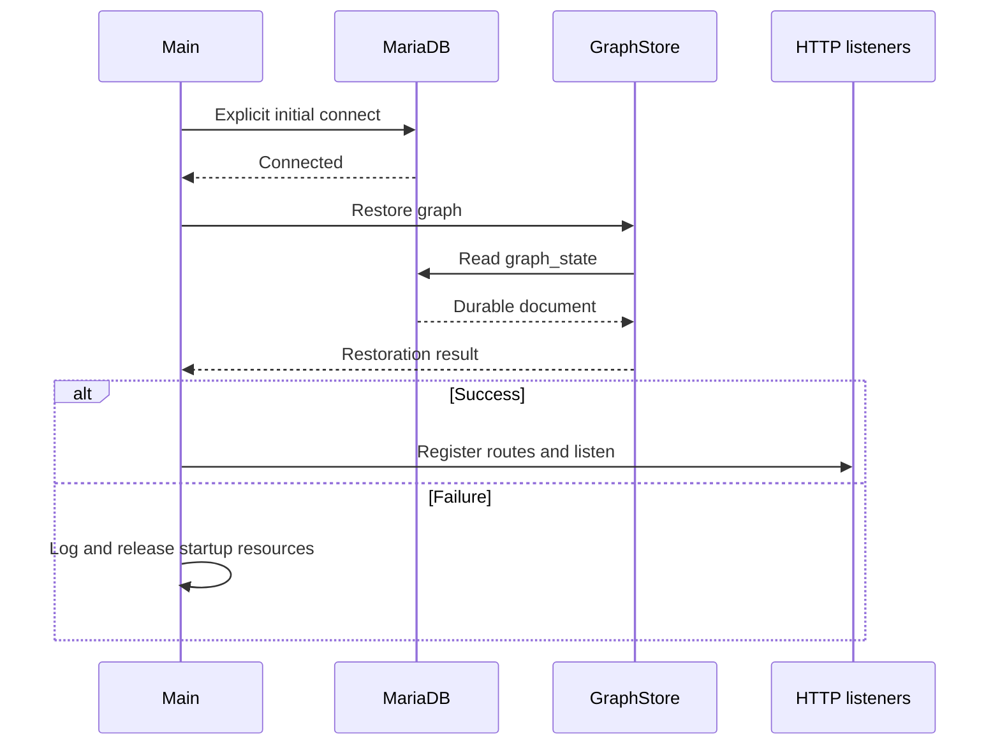

# Architecture and algorithms

core-ci is an externally driven graph controller. GitHub owns the source definitions and
runs the package work; MariaDB owns the durable selections and execution evidence. A
notification or explicit operator request applies facts to that graph, traverses eligible
work and dispatches it to GitHub. The web interface displays the same graph.

The governing rule is simple: **dispatch independent eligible work, and release a dependency
only after its exact prerequisite package publication is verified.** Actual feed mutations
are serialized by the trusted GitHub workflows. The controller reserves no runners and has
no publication-admission quota.

This document describes the source implementation. Its local checks use real isolated
MariaDB and synthetic GitHub services. Real GitHub builds, signing, feed exclusion and
public-page timing have not yet accepted this rewrite.

## Ownership and process lifetime

| Component | Responsibility |
| --- | --- |
| `main.cpp` | Register configuration and HTTP instances, initialize SNode.C once, own database/application lifetime, register routes and SSE |
| `ManagedDatabase` and `DatabaseConfig` | Optional owned MariaDB process and explicit connection settings |
| `Database` | One FIFO of asynchronous reads and lazy writes; preserve uncertain write outcomes |
| `GraphStore` | One applied graph, restoration, durable graph changes and public/UI projections |
| `graph` functions | Definition relationships, immutable selections, eligibility, assignments and monotonic evidence transitions |
| `SourceReader` and `Enrollment` | Authoritative Git definitions, package namespaces, previews and guarded edits |
| `Pipeline` | GitHub proof, dispatch, standard notifications, artifact completion, reconciliation and derivative status dispatch |
| `GitHub`, `HttpClient` and `FeedProof` | Scoped authentication, bounded asynchronous transport and independent committed/public receipt proof |

There is one framework event loop and no controller worker thread, polling timer or ready
queue. Network and database operations complete through callbacks. Successive dependent HTTP
reads remain ordered because each supplies an identity needed by the next; independent
reads and dispatches overlap.

Configuration and named instances are registered before `SNodeC::init()`. Managed mode
starts its owned server and connects when readiness is reported. Unmanaged mode connects
to an externally managed server without controlling its lifecycle. The initial successful
connection restores the graph before listeners start. An initial connection or restoration
failure releases application resources without opening those listeners. `main` ends by
returning `SNodeC::start()`.



## Selecting versions and relationships

An enrolled repository identifies its GitHub repository ID and dispatch branch. Its
`ci/packages.json` defines package names, prerequisite repositories, build hooks and target
rows. The controller reads selected definitions at immutable commits; the enrollment
snapshot alone does not determine dependencies.

Automatic selection reads tags and chooses the highest numeric SemVer, including
prereleases. Explicit requests can select older tags. Annotated tags are resolved to their
commit. Where a tag notification supplies the expected tag object, a matching selected tag
must still identify that object. An automatic push also supplies a minimum tag, so a shared
tag-list response cannot hide that notification's newer version. Explicit requests still
select exactly the requested tag.

Before committing, selection checks the enrollment identity and branch, deployment pins and
current namespaces. It rejects a newer or incomparable source selection created while its
reads were outstanding. Ordinary job progress and retries do not invalidate those reads.
An explicit older root version is allowed; conflicting equal-version identities are not.
A real competing-source conflict is reported without automatic reselection.

Source reads overlap. Selection reports unreadable repositories and remains blocked when
a newly selected definition is unknown. It does not silently omit that repository. The
selected definitions are validated together for cycles, missing prerequisites, matching
package coordinates and package namespace conflicts. Retained selected executions also
reserve their package namespaces.

Traversal includes the requested project and its affected dependents. Prerequisites outside
that affected set need an existing execution at the selected source and target. Missing
prerequisite execution is an explicit error; requesting a dependent does not automatically
build its ancestors. A definition introducing a prerequisite is evaluated from its selected
bytes, even when the enrollment snapshot did not mention that relationship.

A new selection supersedes only older waiting automatic selections. The comparison includes
each node's own source and all transitive prerequisite sources shared by both input closures.
A newer or incomparable old input preserves that waiting work, including after an explicit
older request. A dependency removed by a new definition does not itself prevent supersession.
Assigned work and retained history remain intact. Execution identities include immutable source,
target and prerequisite relationships. Rebuild revisions distinguish attempts and package
versions; an explicit retry keeps the original immutable inputs.

## Traversal and dispatch

The durable states are `waiting`, `building`, `publishing`, `published` and `failed`.
A successful build has a verified build result within `building` until publication is
assigned. Queued/running/completed job evidence supplies additional progress within a state.

| Current facts | Next eligible action |
| --- | --- |
| Waiting; every exact prerequisite verified published | Reserve build assignment |
| Successful verified build result; valid payload | Reserve publication assignment |
| Verified committed receipt and public bytes | Mark published; traverse dependents |
| Definite build failure or trusted skipped publication push | Mark failed; offer explicit retry |
| Missing/inaccessible evidence or possible mutation | Preserve assignment and uncertainty |

`graph::advance` examines all eligible executions in rebuild-revision order. It claims every
ready build or publisher without a controller job quota. Independent targets continue while
another target waits or is uncertain. A diamond join waits for all of its selected edges;
the controller contains no project-specific knowledge of core, app, side or join.

Assignments include source, target, exact prerequisite receipts, deployment pins, execution,
attempt and rebuild revision. They have a canonical digest. Oversized build or publication
inputs remain blocked with a visible reason and do not prevent other assignments.

```mermaid
sequenceDiagram
    participant Event as Notification or operator
    participant Pipeline
    participant Store as GraphStore / Database FIFO
    participant GitHub
    Event->>Pipeline: Accepted immutable facts
    Pipeline->>Store: Enqueue graph transformation
    Store->>Store: Derive against current applied graph
    Store->>Store: Traverse eligible executions
    Store->>Store: Persist assignments atomically
    Store-->>Pipeline: Apply acknowledged state; continue
    par Independent assignment A
        Pipeline->>GitHub: Dispatch A
    and Independent assignment B
        Pipeline->>GitHub: Dispatch B
    end
    Store-->>Event: SSE graph projection
```

Workflow approval resolves the exact dispatch commit and approved regular-file blob. The
preflight proof can be reused when the actual run uses that commit. If the branch advances,
the actual run commit needs fresh proof. A dispatch response's run ID does not supply the
actor/workflow proof. Dispatch authority is always committed before the HTTP mutation. A
lost response never authorizes another dispatch of the same assignment.

GitHub queues the assigned workflows according to its available runners. Publishers validate
artifacts independently, then the feed-mutating jobs share the feed's exclusive concurrency
group. Signing, reading the current feed head, index updates and checked push belong inside
that boundary. Public HTTPS confirmation can run outside it without signing secrets.

## Evidence and completion

The webhook listener verifies the raw-body HMAC, event shape, installation and granted
repository. It acknowledges valid notifications promptly with HTTP 202. Processing then
checks assignment, attempt one, run/job identity, controller actor and approved workflow.
A source hook cannot assert these facts as trusted GitHub execution evidence.

Run and job conclusions remain separate. A job-first report obtains missing run proof;
a bound run's ordinary progress needs no evidence REST read. Run-first, job-first, delayed
and duplicate facts enter the same application path as REST reconciliation. Facts merge
monotonically; terminal outcomes do not regress. Unchanged notifications produce no durable
change, no evidence lookup and no derivative status dispatch.

Successful build completion requires both successful attempt-one run and job evidence.
One coalesced artifact-list request then verifies the assigned artifact's name, run, digest,
size, expiry and bounded result set, together with the trusted job/time binding. Missing or
expired required artifacts fail explicitly. Overlapping reports do not multiply that lookup.
The callback consults the current graph and attempt before accepting the result.

Publication completion waits for terminal workflow and publisher-job evidence, including
the separate confirmation job's effect on the workflow conclusion. A trusted skipped push
or privileged job establishes failure before mutation and needs no feed search. An
unevaluated publisher name is accepted only for the exact skipped-job case, never as proof
of a successful writer. Other possible-push outcomes remain uncertain until independent
publication proof succeeds.

`FeedProof` verifies the configured feed repository, the commit containing the exact receipt,
its regular Git blob bytes and the public HTTPS receipt bytes. The receipt must match the
assigned execution, source, attempt, feed, publication run, assignment digest and accepted
build result. Pinned worker tooling validates package bytes and signatures. Only then
is the edge satisfied. The controller records its own verification UTC; it does not invent
a package's earlier publication timestamp or process package contents locally.

## Persistence and recovery

The fresh schema stores one graph document in the single `graph_state` row. The document
contains enrollment, immutable selections, prerequisite IDs and every retained attempt.
`GraphStore` is the only applied in-memory authority. A write is derived when it reaches the
front of the existing Database FIFO, against all earlier acknowledged changes. It performs
one conditional autocommitted UPDATE using the current generation.

After acknowledgement, state application and generation advancement precede the next write.
That change's execution continuation runs before derivative public-status work. No SQL
transaction stays open across HTTP. Preparation errors and definite SQL rejection do not
apply the proposed state. A lost write acknowledgement latches mutation uncertainty and
prevents later producers from guessing whether the mutation landed. Explicit restart restores
the durable document; it does not replay the uncertain mutation.

This design copies and rewrites retained graph history per change. Small local fixtures do
not establish its cost for a large accumulated history. Capacity and history-scaling acceptance
remain unmeasured. The schema is fresh: there is no importer or migration from another schema.
An existing feed also requires an operator-reviewed rebuild-revision seed above retained
versions before a fresh graph can safely publish into that namespace.

Restoration keeps exact identities. Startup reconciliation fails an assigned attempt only
when there is no committed stage preflight, dispatch identity or bound run: this proves the
workflow was never submitted. That failure permits an explicit retry with a new revision.
A committed preflight without a known run remains uncertain and is never redispatched.
Ordinary operator reconciliation cannot cancel a live preflight. Reconciliation reads the
assigned attempt-one run/jobs and applies their facts through the same validation path.
An unknown dispatch can search for exactly one matching controller-actor run; ambiguous or
inaccessible evidence preserves the assignment. UI reruns cannot replace attempt-one evidence
or authorize a rerun worker to mutate the feed.

The installed MariaDB client has a separately confirmed recovery limitation: an immediate
reconnection failure can discard a queued command without delivering its error callback.
The controller database FIFO then remains blocked even after the server returns; a process
restart is required. The current controller does not work around that dependency defect.
Resolving it needs a separately scoped framework change before recovery acceptance.

The accepted crash boundary remains: a tag notification acknowledged before its selection
was persisted requires explicit request/rescan or redelivery. There is no durable webhook inbox.

## UI, SSE and public status

`GET /api/graph` returns the graph projection, current attempt, blockers, evidence, timing and
verified links without private assignments. `GET /api/events` sends the initial graph and
repository list, then graph changes and enrollment updates. The view is built for connected
SSE receivers; the existing heartbeat keeps idle streams alive. The reused browser assets
render these facts without becoming an execution authority.

Public status uses a restricted projection from the same graph. Publicly meaningful evidence
changes, including within-state progress, request a trusted status workflow. Private approval
and dispatch bookkeeping alone does not. Overlapping generations coalesce while approval or
dispatch is in flight; the captured minimum generation is dispatched and newer work follows.
An uncertain dispatch is not blindly replayed. Each real refresh still costs approval and
HTTP work, runner setup and GitHub Pages propagation. Its live cost is not zero or established
by the controller's local response time.

Templates and package processing remain in trusted pinned worker tooling. They receive
structured projects, target executions, publication receipts, prerequisites and public facts;
owner-defined presentation does not authorize execution. Controller persistence, SSE,
worker refresh, feed commit and Pages visibility are distinct observable milestones.
