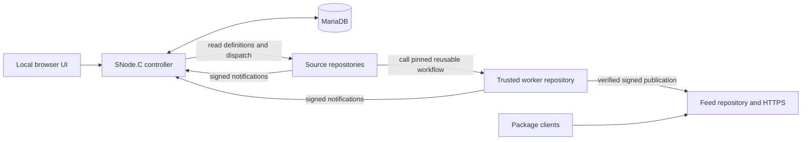
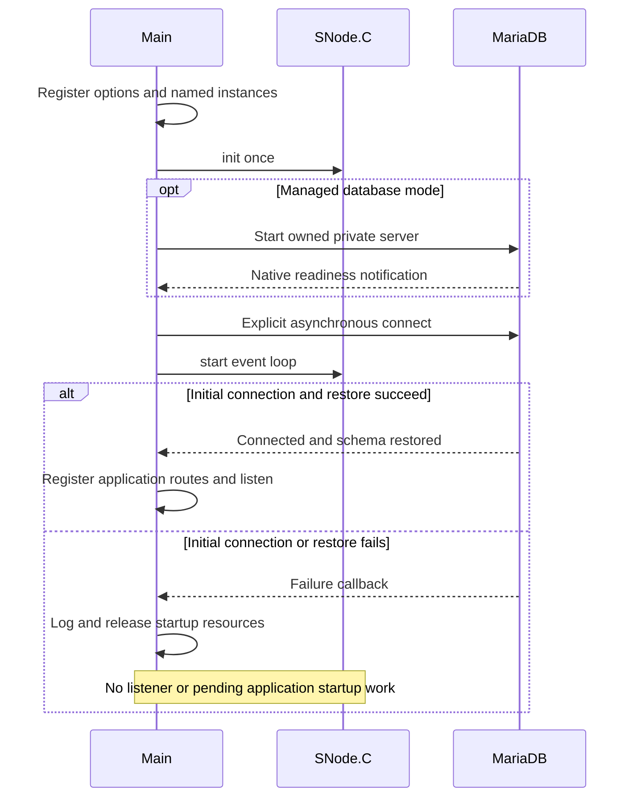
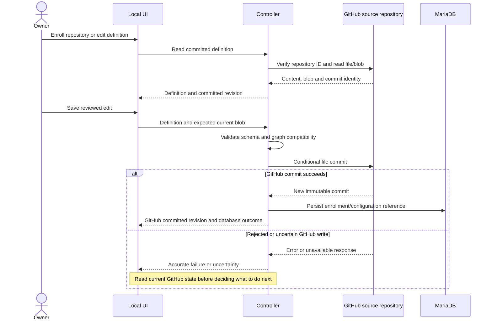
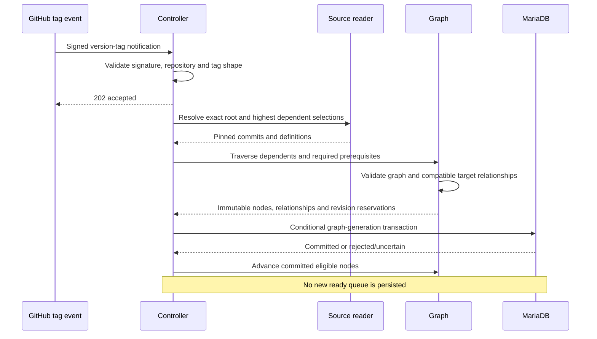
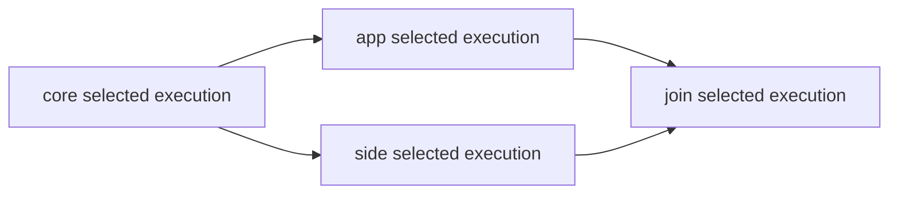
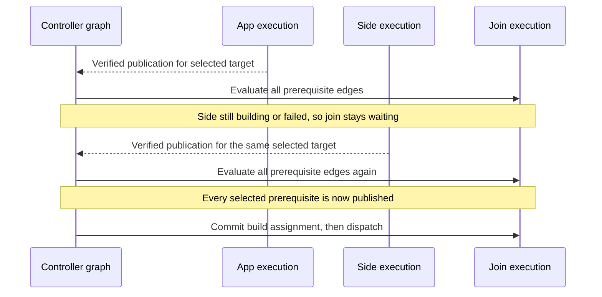
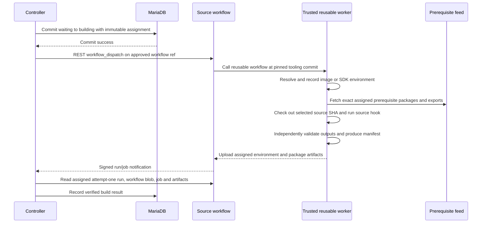
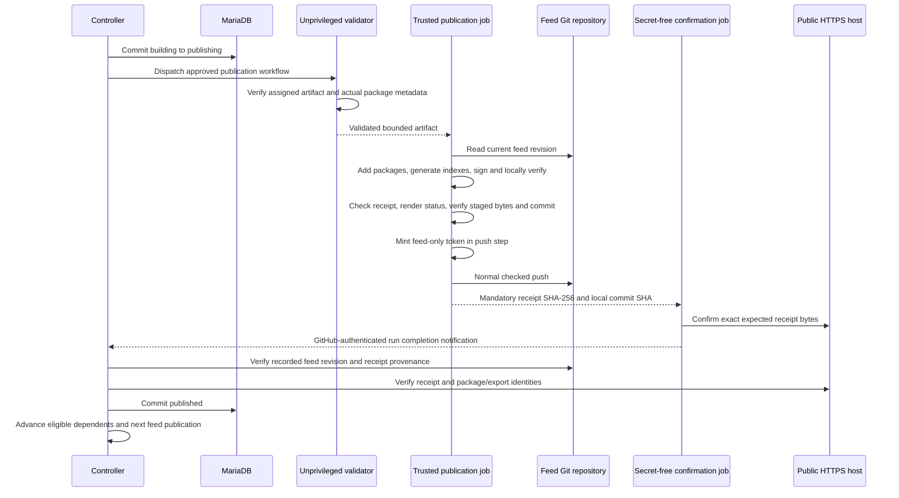
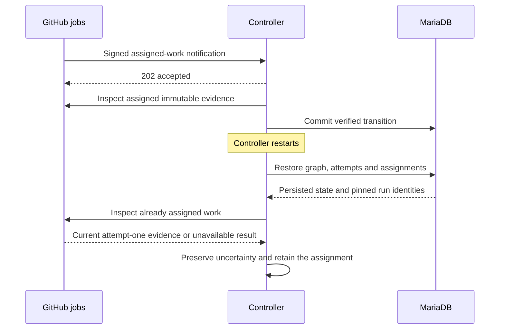
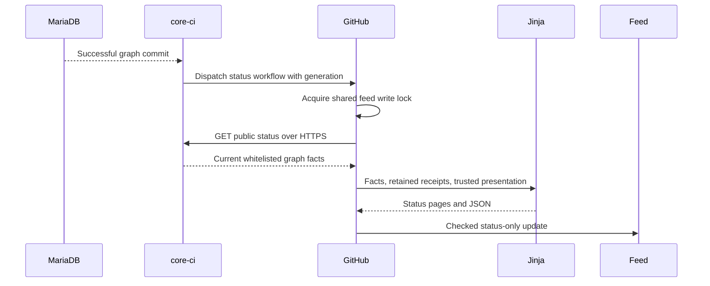

# Architecture and algorithms

[Documentation guide](../README.md) · [Extension guide](../extensions/README.md) ·
[Deployment and operations](../deployment/README.md)

core-ci maintains a small dependency graph whose nodes are package executions. It does not
interpret an arbitrary workflow language. Its decisions are concrete: which source and target
to select, which prerequisite executions belong to that selection, whether a node may build,
and whether a reported publication is sufficiently verified to release its dependents.

## Contents

- [1. The four ownership boundaries](#1-the-four-ownership-boundaries)
- [2. Process lifecycle and callback ownership](#2-process-lifecycle-and-callback-ownership)
- [3. Enrollment and authoritative configuration](#3-enrollment-and-authoritative-configuration)
- [4. Selecting a source version](#4-selecting-a-source-version)
- [5. Building the affected graph](#5-building-the-affected-graph)
- [6. Eligibility and the five states](#6-eligibility-and-the-five-states)
- [7. Dispatching a build and recording evidence](#7-dispatching-a-build-and-recording-evidence)
- [8. Publication is a separate trust boundary](#8-publication-is-a-separate-trust-boundary)
- [9. Notifications, reruns and recovery](#9-notifications-reruns-and-recovery)
- [10. Persistence, names and observability](#10-persistence-names-and-observability)
- [11. HTTP interfaces and their callers](#11-http-interfaces-and-their-callers)

## 1. The four ownership boundaries



The controller owns decisions and persistence. Source repositories own their definitions and
project hooks. Trusted worker code owns the reusable build contract and privileged publication.
The feed owns retained public package bytes and verification material. Keeping these roles
separate means a source hook can compile its project without gaining the ability to sign or
publish another project's packages.

MariaDB is authoritative for enrollment and execution state. It is not a second configuration
editor: build definitions are authoritative GitHub files at recorded commits. The database
retains those immutable definitions so execution evidence can be restored and checked.

## 2. Process lifecycle and callback ownership

The application uses one SNode.C event loop. Configuration options and named instances are
registered before `core::SNodeC::init()`. Initialization runs once. The database ownership mode
is explicit, and the initial connection is established with `MariaDBClient::connect()`.

Only initial database success starts schema/enrollment restoration, application routes and
listeners. Initial failure logs and releases resources without opening a listener. Main ends
with `core::SNodeC::start()`. There is no application startup polling, retry thread, next-tick
startup mechanism or explicit application exit framework.



Requests and transaction contexts are retained by callback-owned objects while asynchronous
operations are outstanding. The HTTP helper overlaps up to eight operations for the current
origin, retaining each request until its transport closes. An origin change waits for active
transports to drain. Independent enrolled-source reads share this bounded transport capacity;
selection waits for all required results and reports failures in enrollment order.
The database wrapper serializes complete transactions on its connection. A graph mutation is
derived only at the front of that existing FIFO, against already applied state. Commit success
applies the graph and advances its generation before releasing the FIFO; its execution
continuation runs before derivative status/SSE notification. No transaction waits for HTTP.
These transient ownership FIFOs are not a persisted queue of ready graph work. Later database commands use
SNode.C's lazy connection establishment after the connection disappears. They do not replay
an operation whose mutation outcome is unknown.

Implementation: [main.cpp](../../src/main.cpp), [Database.cpp](../../src/Database.cpp),
[HttpClient.cpp](../../src/HttpClient.cpp), [ManagedDatabase.cpp](../../src/ManagedDatabase.cpp).

## 3. Enrollment and authoritative configuration

Enrollment associates an explicitly authorized GitHub repository ID with a unique repository
name and editing ref. A name alone cannot grant access. The controller checks returned GitHub
IDs against server-side grants, then reads or conditionally commits `ci/packages.json`.

The UI's editing branch determines where configuration edits are committed. The definition
used by a build is read at its selected source commit. Saving JSON on a branch therefore does
not silently replace the definition or hooks in an existing execution.



A new enrollment immediately requests its highest semantic-version tag if one exists. No
semantic-version tag means there is no source selection to build. Workflow installation is a
separate preview/commit action; a JSON save does not implicitly write workflow files.

Implementation: [Enrollment.cpp](../../src/Enrollment.cpp),
[Definition.cpp](../../src/Definition.cpp), [SourceReader.cpp](../../src/SourceReader.cpp).

## 4. Selecting a source version

An explicit request selects exactly its requested tag, including an older version. An automatic
dependent selection chooses the highest numeric SemVer, including prereleases. Neither path
substitutes the default branch or the last published package version.

The algorithm enumerates tags, ignores non-SemVer names and compares major/minor/patch as
numbers. Numeric prerelease identifiers sort numerically and before nonnumeric identifiers;
a final release sorts after its prereleases. Numeric strings are compared without converting
arbitrarily large version components to machine integers. Build metadata does not change
SemVer precedence. If different tags share the highest precedence, automatic selection is
ambiguous and an exact tag must be requested.

After choosing a tag, core-ci resolves its Git object, peels annotated tags to a commit, and
reads the definition and source hook paths at that commit. Tag-object identity is retained as
well as the commit. A moved tag creates another selection; it cannot alter assigned inputs.
Tag references containing `+` are encoded correctly when used in REST paths.

A selection reads the enrolled repositories' selected definitions to discover affected
relationships. An unreadable selected definition can conceal a dependent relationship; it
blocks the request and identifies the repository. An older cached definition is not substituted
for an unreadable newly selected version.

Implementation: [Version.cpp](../../src/Version.cpp), [SourceReader.cpp](../../src/SourceReader.cpp),
[Pipeline::readSources](../../src/Pipeline.cpp).

## 5. Building the affected graph

There are two levels to the model. Repository definitions declare dependencies. The execution
graph then resolves those relationships for concrete source selections and compatible target
rows. An execution contains its immutable source, target, prerequisite execution IDs and an
ordered list of attempts. An attempt holds state, a globally reserved rebuild revision,
assignment and verified run/result/publication evidence.

Target compatibility compares family, distribution, suite, architecture and format, plus
native platform or OpenWrt target. The row ID identifies the row within its repository;
the coordinate comparison establishes compatibility across repositories. The runner is a
placement selector, not proof of ABI or SDK compatibility.

Graph selection proceeds in this order:

1. Invert dependency declarations into a dependent adjacency map.
2. Traverse from the requested root through affected dependents.
3. Visit their prerequisites in dependency-first order, validating cycles, namespaces and
   missing or ambiguous target matches.
4. For each affected repository/target, select prerequisite execution IDs. Unaffected
   prerequisites must already have matching selected work; core-ci does not build upward
   automatically just to fill a missing prerequisite.
5. Derive the execution identity from immutable source, target and prerequisite identities.
   Reuse an existing identical selection instead of creating duplicate work.
6. Reserve revisions for new attempts. Supersede only older waiting automatic selections;
   preserve their records. Assigned work and explicit older requests remain intact.
7. Commit the change only if the graph generation is still the generation that was read.



### Why the diamond waits

Suppose `core` is used by both `app` and `side`, and `join` needs both branches. For one
compatible target, a changed `core` creates corresponding affected selections. `app` and
`side` each wait for the selected `core` publication. `join` waits for the selected `app`
**and** selected `side` publications. Publishing `app` while `side` is still building or failed
does not satisfy the second edge. Another target can advance independently.





The messages above represent verified graph transitions, not success strings sent by source
hooks. If side fails, only an explicit retry and its verified publication can satisfy that
selected edge. A successful build without publication cannot release join.

Implementation: [Graph.cpp](../../src/Graph.cpp), [Definition::coordinates](../../src/Definition.cpp).

## 6. Eligibility and the five states

| State | Meaning | How it advances |
| --- | --- | --- |
| `waiting` | Selected but not assigned to GitHub | All prerequisites are verified published and payload is supported |
| `building` | Build authorized; may be running, uncertain or complete awaiting publication | Verified build evidence is recorded, then the feed writer becomes available |
| `publishing` | Publication authorized; outcome may still be uncertain | Verified feed receipt and bytes, or definitive proof of a pre-push failure |
| `published` | The package repository update and receipt are verified | Satisfies the corresponding prerequisite edge |
| `failed` | A definite failure with a recorded reason | Explicit retry creates another attempt/rebuild revision |

There is deliberately no separate persisted ready or built state. A completed build remains
`building` with a build result until it can obtain publication authority. Blockers and UI
activity text are derived from the graph and evidence.

An oversized dispatch remains visible with a derived blocker. Its assignment and full escaped
REST input payload are bounded before a transition commits; publication includes `build_result`.
It does not consume a writer slot or stop unrelated nodes advancing. Assignments are limited
to 60,000 bytes and full serialized dispatch inputs to 65,535 bytes.

The graph admits up to eight publication assignments per feed repository ID and branch.
Uncertain assignments retain their slots and cannot satisfy dependents, while independent work
may proceed within capacity. GitHub serializes only the actual feed-mutating publication job
and status writer in one shared concurrency group. Artifact validation and public HTTPS
confirmation run outside that group. The normal checked Git update remains required.

## 7. Dispatching a build and recording evidence

The controller reserves an assignment in MariaDB **before** making the REST dispatch. The
assignment contains source/definition/target identities, exact prerequisite receipts, tooling
pins, a safe artifact name, revision and derived readable label. Its canonical SHA-256 remains
part of the contract even though the GitHub run title is readable.



Workflow checkout and source checkout are different identities. The thin workflow dispatches
from its approved ref; the worker explicitly checks out the assignment's source commit.
Roots resolve the latest official SDK for their configured series; dependents reuse the exact
compatible SDK of their prerequisites. Retries reuse recorded environment evidence rather
than resolving a different image/SDK under the same selected inputs.

A successful completed build with a complete artifact listing that proves its required package
artifact missing/expired becomes `failed`. Denied, incomplete or inaccessible evidence stays
uncertain. Missing environment evidence after a possible build prevents retry from silently
choosing a different environment.

## 8. Publication is a separate trust boundary

An Actions artifact is only an intermediate result. Publication means packages and signed
indexes are available at the configured HTTPS feed. The publisher's unprivileged validator
checks the assigned run/job/artifact and package metadata. Its privileged job has the signing
and feed-write secrets; it does not execute source hooks, installers or artifact scripts.



Preparation performs deterministic fallible work before the push step. A verified skipped
push step is definite pre-push evidence. Failure after that step starts remains uncertain,
even if token minting or another local operation failed before the actual push. A missing
receipt, empty job list or failed job alone does not prove that no feed mutation happened.

Signed package hashes can differ from unsigned build hashes. Receipts preserve both the
build provenance and final published identities. An identical publication replay verifies
retained bytes and avoids unnecessary signing/commits. Different bytes under an already
published package identity are rejected.

Implementation: [publish.py](../../deployment/worker/core_ci/publish.py),
[validate.py](../../deployment/worker/core_ci/validate.py), [FeedProof.cpp](../../src/FeedProof.cpp).

## 9. Notifications, reruns and recovery

Every public notification is authenticated against the raw request body. Repository and
installation identity are checked. A report is matched to assigned work; an arbitrary success
string or unrelated run ID cannot publish a node. The controller reads immutable attempt-one
endpoints. A GitHub UI rerun cannot replace that evidence, and worker processes executing
attempt two or later refuse before mutable environment/build/publication work.

Acknowledgement is separate from processing success. Accepted notifications return promptly;
`GitHub webhook completed` log entries contain the eventual processing status/result. There
is no durable notification inbox. The accepted crash window is between acknowledgement and
persisting a new selection; explicit tag request/rescan or GitHub redelivery closes it.



If the database commit outcome is uncertain, further mutations are blocked until restart and
restoration establish durable state. A definite conditional rollback caused by an advanced
generation can be revalidated once against the current graph; that narrow case is not an
uncertain-mutation retry policy. Graph and SQL generation/state guards remain authoritative.

## 10. Persistence, names and observability

`repositories`, `definitions` and `namespace_claims` retain enrollment/configuration references.
`executions` and `prerequisites` retain immutable graph selections and edges. `attempts` retain
revisions, assignments, states, run identities, results, receipts and failures. `graph_revision`
contains the conditional generation and next rebuild revision allocator.

Readable labels are derived execution metadata, not an independently editable naming authority.
The desktop UI shows work in a compact table, with repository editing in a separate tab.
Stage, source version and target coordinates are explicit; full identities are expandable.
The local `/api/events` SSE route uses SNode.C `sendHeader()`/`sendFragment()` response
streaming, following MQTTSuite's receiver/disconnect pattern. A connection receives current
graph and repository views. The existing graph store notifies the stream after write completion;
only successful transactions advance graph state. Uncertain failures expose the mutation guard
without inventing a transition. Each connection sends a `:keep-alive` SSE comment every
30 seconds through SNode.C's interval timer. The disconnect callback cancels that timer and
releases the response. Comments cause no browser data event, graph mutation or GitHub work.

Browser `EventSource` reconnects automatically and receives a fresh current view; no event log,
replay queue or GitHub polling is added. Search, selection and unsaved
repository drafts survive incoming events and stream reconnection. A changed remote definition
is announced without replacing the draft or its original conditional-write revision. `Live`
means the stream is connected, not that every execution or external service is healthy.
"Inspect assigned GitHub work" remains an explicit action and is independent of SSE delivery.
Execution details show the first controller verification time as **Publication verified**,
formatted in the browser's local timezone. The `publication_verified_utc` field belongs to the
controller and is stored in the existing receipt only when the verified publication transition
is recorded. It is an observation time, not the feed commit time or build completion time.
Duplicate reports and restarts preserve it. The host's UTC system clock supplies the value;
existing receipts without that fact stay unrecorded rather than being backfilled.

Compiler versions, test counts, optional coverage and a report link come from `receipt.summary`
and are labelled **Hook-reported build summary**. The source hook reports them; verification
of publication does not independently attest that its tests ran. These optional facts appear
after publication evidence is recorded and do not affect eligibility, signatures or retry.
Missing facts show **Not recorded**. The browser uses text nodes for reported content and
opens HTTPS report links separately with `noopener noreferrer`. Existing graph/SSE delivery
carries this information without another API, state, database column or GitHub request.

The feed's status pages combine retained publication receipts with an explicitly public
projection of the existing graph. `GET /public/status` supplies accepted selected versions
in existing SemVer order, work states, prerequisites, blockers and recorded verification times.
It excludes execution assignments and deployment credentials. The public TLS listener still
has no administration routes. The projection is derived data, never another graph authority.

A successful commit dispatches the trusted status workflow with a generation number. After
acquiring the shared feed lock, GitHub fetches current facts and renders the deployment-owned
Jinja templates. Publication uses the same renderer and retains the latest public projection.
The template owns Available: select the highest selected source version, find its publication
for the target, otherwise show `—`. Older publications remain available to custom history views.
No controller or worker adapter computes a competing Available field.



A delayed notification fetches current facts rather than carrying an old snapshot. The
writer rejects older/conflicting generations and normal Git conflicts. It never signs packages
or retries an uncertain mutation. Startup or explicit reconciliation can request a fresh status
render. Public pages have workflow/hosting latency; the local management UI uses live SSE.
Unknown historical timestamps and unverified job links remain absent. Publication timestamps
are first controller verification observations, not an invented exact push time.

The controller remains deliberately small: no distribution/runner catalogue, registry/SDK
client, application thread pool, persistent ready queue or generic workflow engine. The HTTP
client's current reuse model is unchanged; changing that ownership boundary is separate work.

## 11. HTTP interfaces and their callers

The browser uses the local administration REST API. The controller uses GitHub's REST API
through SNode.C's asynchronous HTTPS client. GitHub calls the separate public webhook route.
There is no shell `gh` process in a controller event handler; deployment commands using `gh`
are operator tooling, not the controller's HTTP transport.

| Interface | Purpose and main input |
| --- | --- |
| `GET /public/status` | Read-only public graph facts for the configured trusted status workflow |
| `GET /api/repositories` | Enrollments and committed editing definitions |
| `POST /api/repositories/refresh` | Read/enroll a committed definition using `repository` and `branch` |
| `POST /api/repositories/save` | Validate/commit `definition` with repository, branch and expected `revision`/`blob_sha` |
| `POST /api/repositories/workflow` | Preview by repository; conditional write adds `write`, expected `head` and `blob_sha` |
| `GET /api/graph` | Derived execution/state/blocker/identity view, including the immutable `target_row` |
| `GET /api/events` | Local SSE stream with current graph/repository views and automatic reconnect baseline |
| `POST /api/work/request` | Select `repository` and exact `tag`, or empty tag for highest SemVer |
| `POST /api/work/retry` | Explicit retry by `execution` after definite failure |
| `POST /api/work/reconcile` | Inspect assigned GitHub work and advance verified state |
| `GET /api/status` | Actual asynchronous database availability query |
| `POST /github/webhook` on TLS listener | Raw-body authenticated GitHub events |

Configuration-writing requests are JSON operations without Origin/Host restrictions. The public listener does not
expose these administration routes. The trusted workflow does not call a homemade success
callback: GitHub's authenticated run/job events notify core-ci, which fetches assigned evidence
itself before trusting results.

For example, a local exact-version request is:

```sh
curl -H 'Content-Type: application/json' \
  --data '{"repository":"VOC-Experiments/demo-join","tag":"v2.1.3"}' \
  http://127.0.0.1:8080/api/work/request
```

This is an action, not a read-only probe. Do not blindly repeat it after losing the response.
Inspect the graph first. An HTTP success for webhook acceptance does not mean that this
selection/dispatch/publication sequence has already completed.
