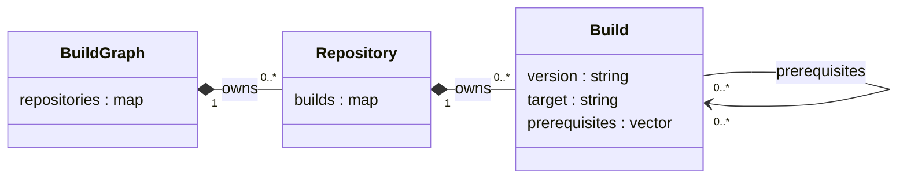

# Build graph

## Input documents

Each repository supplies a document matching
[repository-builds.schema.json](../schema/repository-builds.schema.json).
`repository` identifies the repository. Each key in `builds` identifies a build
within that repository. `version` and `target` are plain string labels.

A prerequisite is a pair: `repository` and `build`. Build IDs are local to their
repository; the pair identifies the referenced build across all documents.
Reading multiple repository documents must produce one combined graph. Every
reference to the same pair points to the same build object.

The schema specifies JSON shape only. It contains no version syntax, version
comparison, target compatibility, dependency-selection or cycle rules. This step
does not implement a reader, reference resolution or any traversal algorithm.

## Class diagram



The exact C++ member types are:

| Owner | Member | Type |
|---|---|---|
| `BuildGraph` | `repositories` | `std::map<std::string, std::unique_ptr<Repository>>` |
| `Repository` | `builds` | `std::map<std::string, std::unique_ptr<Build>>` |
| `Build` | `version` | `std::string` |
| `Build` | `target` | `std::string` |
| `Build` | `prerequisites` | `std::vector<Build*>` |

Repository and build identities are their owning map keys. Each build has exactly
one owner. Prerequisite pointers are non-owning links to those existing objects;
they do not create copies or transfer ownership. All build objects live within
the owning graph's lifetime. No reverse dependency collection is stored.

## Object diagram for the four example documents

```mermaid
flowchart TB
    graph["graph : BuildGraph"]
    coreRepo["example/core : Repository"]
    appRepo["example/app : Repository"]
    sideRepo["example/side : Repository"]
    joinRepo["example/join : Repository"]
    core["linux-amd64 : Build — core"]
    app["linux-amd64 : Build — app"]
    side["linux-amd64 : Build — side"]
    join["linux-amd64 : Build — join"]
    graph -->|owns| coreRepo
    graph -->|owns| appRepo
    graph -->|owns| sideRepo
    graph -->|owns| joinRepo
    coreRepo -->|owns| core
    appRepo -->|owns| app
    sideRepo -->|owns| side
    joinRepo -->|owns| join
    app -. prerequisite .-> core
    side -. prerequisite .-> core
    join -. prerequisite .-> app
    join -. prerequisite .-> side
```

The expected result contains four repositories and four build objects, with four
prerequisite links. App and side share the single core build object. Join links
to the existing app and side objects. Ownership forms a hierarchy; dependency
links form the graph.
