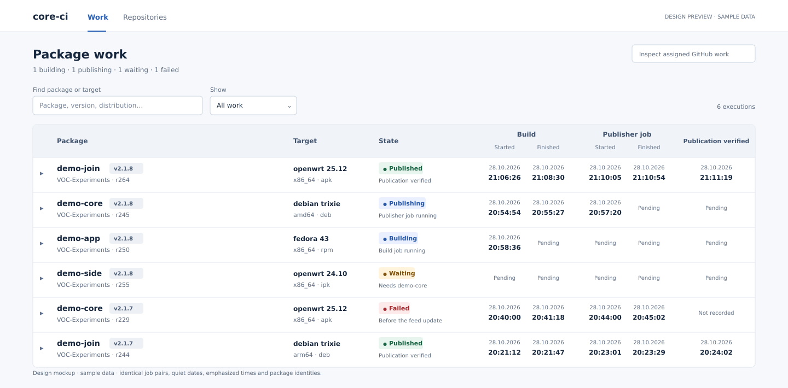

# Package work: design proposal

This describes the implemented Work-page presentation and its design references. The
standalone preview uses synthetic data, works without a controller and performs no remote
or mutation requests. Controller logic, database schema, API and workflows are unchanged.

[Interactive HTML preview](preview.html) · [1440px overview](overview.png) ·
[1280px overview](compact.png) · [Expanded execution](details.png)

Open `preview.html` in a browser to try search, status filtering and row expansion. The PNG
and SVG files are deliberately drawn design mockups, not screenshots of that HTML or the
live application. The mockups were rendered and visually inspected; the HTML still requires
browser verification.

## What the user needs to discover

Read the row from left to right:

1. Which package and source version is this? Which rebuild?
2. Which distribution, series and architecture?
3. What is happening, or what needs attention?
4. When did its build and publication jobs start and finish?
5. Has publication actually been verified, and when?

The row must remain recognizable as progress changes. Expanding it supplies explanations,
durations, dependencies, logs, operator actions and complete technical identities. No new
execution state, authority, API, fetching policy or workflow is part of this design.

## Reference review

These are design references, not dependencies to install.

| Reference | Relevant guidance or product behavior | Application here |
| --- | --- | --- |
| [GitLab Pajamas tables](https://design.gitlab.com/components/table/) | Orders columns by user importance; warns against both stretching sparse data and squeezing tables; recommends clear alignment and horizontal separators. | Identity first, controlled timing widths, restrained separators and no cell-by-cell grid. |
| [Carbon data tables](https://www.carbondesignsystem.com/building-blocks/core/components/data-table/guidelines) | Keeps table tools together and supports expandable rows for secondary information. Provides consistent density choices. | Compact toolbar, consistent two-line summary rows, detailed evidence below the chosen execution. |
| [GOV.UK tables](https://design-system.service.gov.uk/components/table/) | Uses semantic table headers to support comparison and scanning. | Native table and row headers; group/field names remain understandable to assistive technology. |
| [Buildkite dashboard walkthrough](https://buildkite.com/docs/pipelines/dashboard-walkthrough) | Separates overview/filtering from job detail and execution actions. | Progress can be scanned first; logs, dependencies and conditional actions are available in the expanded execution. |

The proposed typography and spacing are design decisions for this application. The references
do not establish that this exact layout is usable; that needs rendered and owner review.

## Visual hierarchy

**Package identity gets the strongest text emphasis.** The repository basename is bold;
the complete source tag sits alongside in a small neutral treatment. The owner and rebuild
revision appear beneath. Both parts of the repository identity remain visible; the complete
qualified name is available for copying and in the expanded facts. Names are never reduced
to a SHA or silently shortened into indistinguishable labels.

**Target is a compact two-line unit.** Distribution and series form its first line, with
moderate emphasis. Architecture and package format form the quieter second line. Format
remains available without consuming its own column.

**State is stable and readable.** A small text label uses restrained semantic colour. A short
activity line distinguishes job progress from the overall execution state. Colour is never
the only indication. Long failures or activities can wrap within this column; they cannot
move the timing columns. Full failure and blocker explanations remain in the expansion.

**Times are easier to scan than repeated dates.** Every recorded timestamp keeps the date
on its first line and time on its second. The date is quieter; the time uses semibold,
tabular figures. Both are centered. Production retains browser-local formatting, the current
24-hour time format, full accessible timestamp labels and the existing no-timezone-label
requirement. The mockup's Austrian-style date is sample formatting, not a hard-coded locale.

**Pending is distinct from Not recorded.** Preserve the existing evidence-based distinction.
No invented finish, duration, percentage, remote queue reason or completion is shown.

Rows normally contain two lines, approximately 60–64px high. Long real content may increase
height rather than being hidden. Hover/focus and the expanded row use a subtle background.
The page uses a compact heading and summary, not oversized cards or large counters.

Any number of executions can be expanded simultaneously. Closing one affects only that
execution; dependency navigation opens its target and scrolls its summary into view. Live updates retain open
rows and each visible technical disclosure independently. Filtering temporarily hides rows
without clearing their expansion choices. All three timing headings share colour, size and weight.

## One stage, one column

The table has seven physical columns:

| Column | Width policy | Contents |
| --- | --- | --- |
| Disclosure | 32px | Keyboard-operable details button and expanded state |
| Package | 208px | Name, full tag, owner and rebuild revision |
| Target | 156px | Distribution/series and architecture/format |
| State | 128px | Overall state plus exact known activity |
| Build | 184px | Identical Started/Finished pair |
| Publisher job | 184px | Identical Started/Finished pair |
| Publication verified | 156px | Verified timestamp, Pending or Not recorded |

Each job column has one inner grid shared by its header labels and timestamp pair:
two 72px tracks, an 8px inner gap and 16px padding at each outside edge. This gives an
80px center-to-center distance inside each pair and 104px between adjacent pairs. The
Build and Publisher job names are centered over their respective pairs.

There are no spanning job columns and no `col span` width rules. Each stage is one native
column, with its pair laid out inside the cell. Thus the browser cannot independently assign
a different width to Publisher's Started and Finished. At 1280px and 1440px the same stage
geometry is used. Package and State do not absorb spare space. The table stays compact
instead of stretching its columns across a large screen.

Table width is 1048px (1050px including its wrapper borders). Smaller windows retain legible text and horizontal scrolling;
controls can wrap. All information remains accessible. The disclosure/identity area must not
be pinned so widely that it consumes most of a narrow viewport. No alternate card UI or
second rendering authority is proposed.

## Information and behavior retained

| Existing information or control | New location or treatment |
| --- | --- |
| Repository, tag and rebuild revision | Summary Package cell; full identities in expansion |
| Distribution, series, architecture, package format | Summary Target cell |
| Execution state, activity, superseded designation | Summary State cell; complete activity in expansion |
| Build started and finished | Build pair, date above time |
| Publisher job started and finished | Publisher pair, date above time |
| Publication verified | Separate final column; never inferred from job success |
| Automatic versus explicit selection | Expanded Execution facts |
| Build and publisher durations | Expanded Timing section, preserving missing-data semantics |
| Failure and blocker explanations | Expanded Execution facts; short useful activity in summary |
| Exact prerequisite executions and current states | Expanded prerequisites with existing execution navigation |
| Compiler names/versions | Expanded hook-reported summary |
| Passed, failed and skipped test totals | Expanded hook-reported summary |
| Coverage including zero, optional test report link | Expanded hook-reported summary |
| Build and publication log links | Expanded actions, preserving existing safe external-link handling |
| Retry with a new rebuild revision | Expanded actions, under existing eligibility rules |
| Retirement and explicit uncertainty acknowledgement | Expanded actions, under existing eligibility rules; retry remains separate |
| All source/configuration/assignment/evidence JSON | Existing technical disclosure, unchanged information |
| Search, All/Active and failed/Failed/Published filters | Compact toolbar; retain matching and independent expansion |
| Work counts, visible/total execution count | Compact summary and toolbar/footer |
| Inspect assigned GitHub work | Existing secondary action, without changing reconciliation |
| Connection state, reconnect, Work/Repositories navigation | Retained application shell; preview is explicitly disconnected |
| SSE updates, open executions, technical disclosure state | Existing data flow and event handling |
| Busy/disabled controls and mutation uncertainty | Existing action behavior |

The preview simplifies some facts into labelled fixture examples. It is not a substitute for
the production execution JSON or a demonstration of authenticated actions. It does not add
retry to an uncertain assignment or invent retirement eligibility.

## Implementation boundary and accounting

The authoritative graph, API and SSE remain unchanged. Reuse `timestamp`, `executionPending`,
`duration`, action eligibility and `renderExecution` information. Replace the summary markup
and work-specific styles together; remove the current nine-column spans, positional timing
padding selectors and competing width rules. Do not layer the new table over the old one.

Implementation replaces the previous summary presentation: UI **+57/-24/net33 lines**;
existing public UI fixture **+16/-0/net16 lines**. C++/SQL/workflows/API changes: **zero**.
The owner authorized implementation and commit/push/merge/deployment after reviewing the
20–40 UI / 15–30 fixture line estimate. No framework, library, polling, extra application
state or production test hooks were added.

## Verification before deployment

1. Render the real HTML at 1440px, 1280px, a narrow desktop viewport and 200% zoom. Compare
   bounding rectangles for the two job pairs, their headings and date/time alignment.
2. Exercise Published, Building, Publishing, Waiting, Failed, superseded and unconfirmed
   publication examples. Preserve missing data, terminal history and action eligibility.
3. Apply SSE changes through the existing fixture. Confirm stable columns and preserved
   selected/technical details without new API traffic or duplicate rendering state.
4. Check long owner/package/tag names, custom targets and architecture names, missing
   summaries, coverage zero, multiline errors and German/English date formatting. No value
   may become inaccessible, overlap another cell or disappear behind a width constraint.
5. Test keyboard disclosure, focus, accessible row/column labels, searchable identity,
   dependency navigation, safe logs/report links and unchanged conditional operator controls.
6. Test narrow-window horizontal scrolling, dark appearance and desktop density. The HTML
   prototype shows the light design; production must retain light/dark support.
7. Run only affected UI fixtures and the relevant asset/build checks. Inspect the final
   production build visually when a browser is available; file hashes prove version, not layout.

The isolated fixture HTTP/assets and SSE checks, final Release build, format check and
JS/Python syntax checks pass. These checks are not browser interaction or visual coverage.
Browser automation reports no available browser; rendered HTML, zoom, locale, dark appearance
and keyboard/action interaction verification remain open. The explicit SVG design mockups
were rendered and inspected. Deployment is authorized, but visual owner acceptance is pending.
